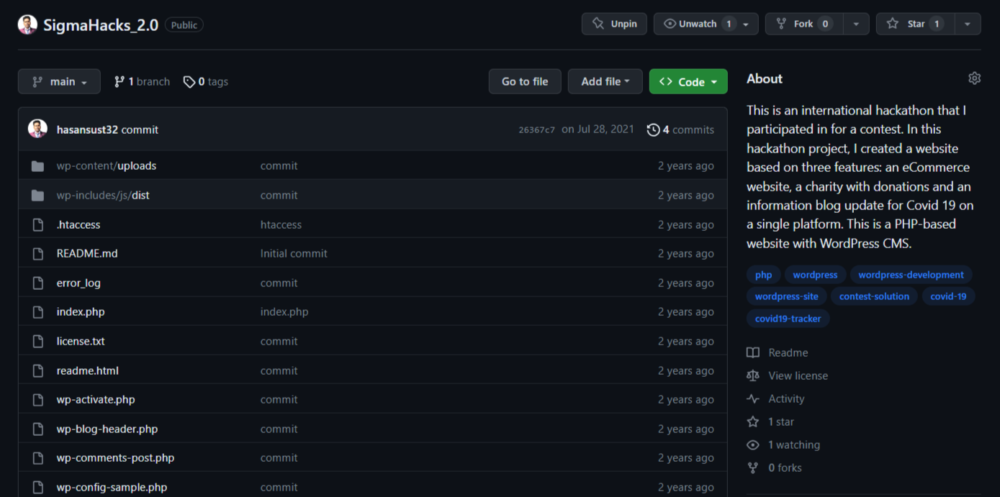

SigmaHacks_2.0
==============

# Introducing Sigmahacks 2.0:
-  Pioneering Solutions for a Resilient Future Welcome to Sigmahacks 2.0, the ultimate online hackathon poised to revolutionize COVID-19 solutions!
- With determination as our compass and innovation as our weapon, we're set to conquer three paramount challenges that have arisen from the pandemic.
- To create tangible and groundbreaking solutions that will reshape the course of this battle.
- Navigating through the uncharted waters of the pandemic, Sigmahacks 2.0 brings together brilliant minds and compassionate hearts to craft ingenious responses to the most pressing issues of our time.
- Through a captivating WordPress website, we'll showcase the brilliance of our strategies and solutions, reflecting our commitment to being at the forefront of the fight against COVID-19.
- With over 300 teams in the arena, we're not just participants; we're contenders for the top 10 spots.
- Our WordPress platform will serve as a virtual canvas where our innovative ideas will be painted with pixels and passion, aiming not only to secure our place among the elite but also to leave an indelible mark on the global response to the pandemic.
- Join us as we brainstorm, code, design, and strategize our way into the upper echelons of Sigmahacks 2.0.
- Sigmahacks 2.0 - where ingenuity meets impact and the future is shaped by the keystrokes of innovation.
- Get ready to witness the dawn of a new era in COVID-19 solutions.

Our Solutions :
================

